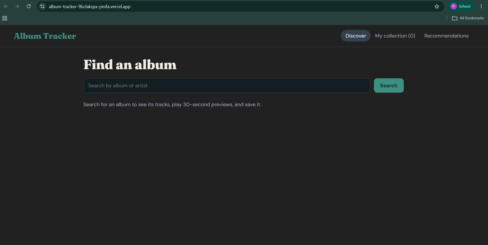

# Album Tracker

Album Tracker is a React web application that lets music listeners search for albums, play 30-second track previews, and maintain a personal listening collection with statuses, star ratings, and notes. It also integrates Deezer's embeddable widget for full-album playback and uses LLM-powered recommendations based on the user's saved albums and ratings.

Live Site: https://album-tracker-9bclakqsx-pmfa.vercel.app

## Features
- Search albums and artists via the iTunes Search API
- Persistent bottom mini player with play/pause, previous/next, and seek bar
- Personal collection saved in browser storage with filtering and sorting
- Full-album playback toggle via the Deezer widget and serverless proxy
- LLM-powered recommendations based on saved albums and star ratings

## Tech Stack
- React & Vite
- Context API & localStorage
- iTunes Search API & Deezer API
- Google Gemini API (via Vercel Serverless Functions)
- Deployed on Vercel

## How to Run Locally
1. Clone the repository and enter the directory.
2. Run `npm install` to install dependencies.
3. Create a `.env.local` file in the root directory with `GEMINI_API_KEY=your_key_here`.
4. Run `npm run dev` and open `http://localhost:5173`.

## Limitations
- iTunes track previews are limited to 30 seconds.
- Your collection is stored locally in your browser (`localStorage`) and does not sync across devices.
- Playing full tracks in the Deezer widget requires being logged into a supported Deezer account in the same browser.

## Privacy & Disclaimer
- **Privacy Note:** The AI recommendations feature sends your saved albums' titles, artists, star ratings, and listening statuses to Google's Gemini API. Your personal album notes are never sent.
- **Disclaimer:** Music data, artwork, and audio belong to their respective owners. This is an educational project and is not affiliated with Apple, Spotify, Deezer, or Google.